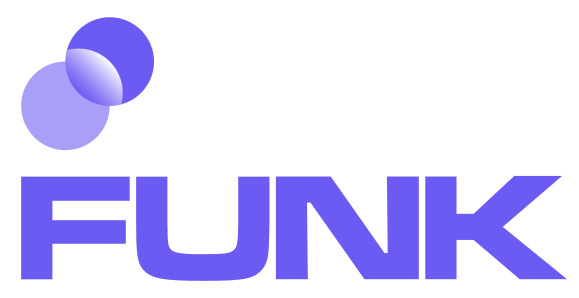

# Lilynk

  

Lilynk streams the desktop and games of a Linux or Windows PC to a Mac, PC, phone, tablet or TV
with low latency. Each client gets its own virtual display at its own native resolution and
refresh rate, so a laptop at 1080p60 and a TV at 4K can stream from one host at once without
rearranging your real monitors.

Lilynk is a GPL-3.0-or-later fork of [punktfunk](https://git.unom.io/unom/punktfunk) by unom,
taken from punktfunk's main at commit `f1e09f58c`, 386 commits after the v0.47.0 tag. See
[License](#license) for how the two licenses apply. Its network protocol differs from punktfunk's,
so punktfunk clients and hosts do not connect to Lilynk.

The documentation lives at [project-colony.github.io/Lilynk](https://project-colony.github.io/Lilynk/).
The site is not published yet; until it is, its pages are in `docs-site/content/docs/`. Start with
[How it works](https://project-colony.github.io/Lilynk/docs/how-it-works),
[Quick start](https://project-colony.github.io/Lilynk/docs/quickstart) and the
[Support matrix](https://project-colony.github.io/Lilynk/docs/support-matrix), which lists what
works on each platform.

Questions and discussion go on [Discord](https://discord.gg/tvFApEEVfj). Bugs and ideas go on
[GitHub issues](https://github.com/Project-Colony/Lilynk/issues). Report a vulnerability
privately through the [advisory form](https://github.com/Project-Colony/Lilynk/security/advisories/new),
not in an issue; see [SECURITY.md](SECURITY.md).

## What it does

- A virtual display can outlive the connection, so a reconnect lands back in the running game. The
  stream can be your only desktop or extend your monitors, and several devices can act as monitors
  of one desktop. The console has presets for each
  ([Virtual displays](https://project-colony.github.io/Lilynk/docs/virtual-displays)).
- Linux hosts use each compositor's own virtual outputs. Windows hosts get the same from Lilynk's
  IddCx driver (`ly-vdisplay`), created on the fly. It needs no dummy HDMI plug, captures without
  Desktop Duplication or WGC, and keeps working on the secure desktop (UAC, lock screen).
- Frames reach the encoder with no CPU copies: dmabuf to CUDA or Vulkan to NVENC on Linux, and
  NVENC, AMF, QSV or Media Foundation on Windows. On a wired link,
  [PyroWave](https://project-colony.github.io/Lilynk/docs/pyrowave), an intra-only wavelet codec
  that runs as Vulkan compute, spends bandwidth to cut codec latency by an order of magnitude.
  Every PyroWave frame is a keyframe, so a loss costs one frame instead of a recovery round trip.
- The native protocol runs over QUIC on one UDP port. Its media plane is encrypted with AES-GCM. The
  GF(2¹⁶) Leopard-RS FEC keeps working past about 1 Gbps, and the stream mode can change
  mid-stream. The same process can also serve any [Moonlight](https://moonlight-stream.org/)
  client with `serve --gamestream`. That mode is opt-in and for trusted LANs only, because
  GameStream has on-path weaknesses in its design.
- Steam and non-Steam games appear as a grid on every client.
  [Plugins](https://project-colony.github.io/Lilynk/docs/plugins) add other sources: ROM Manager,
  Playnite, Ubisoft Connect, Battle.net, itch.io, Flatpak and more.
- A client pairs once with a SPAKE2 PIN and then reconnects to the pinned host identity. There are
  no accounts and no cloud service. Hosts advertise over mDNS, so clients find them without an IP
  address.

## Install

Lilynk has no packages, installers or store listings yet. Build the host and the clients from
source: [Build from source](https://project-colony.github.io/Lilynk/docs/developers/build-from-source)
has the steps for each platform. The Windows host needs Windows 11 22H2 (build 22621) or newer,
because the display driver needs IddCx 1.10.

## Clients

| Streaming to | Client | Source |
| --- | --- | --- |
| Mac, iPhone, iPad, Apple TV | The Apple app | `clients/apple` |
| Linux desktop or laptop | `lilynk-client` | `clients/linux` |
| Steam Deck | The Decky plugin in Gaming Mode, `lilynk-client` in Desktop Mode | `clients/decky` |
| Android phone or TV | The Android app | `clients/android` |
| Windows | `lilynk-client-windows` | `clients/windows` |
| Scripts and launchers | `lilynk`, the headless CLI | `clients/cli` |
| Anything else | Moonlight, over GameStream | |

Every client finds hosts on the network and pairs once with a
[PIN](https://project-colony.github.io/Lilynk/docs/pairing).

## Develop

Building, testing and contributing are in the
[developer docs](https://project-colony.github.io/Lilynk/docs/developers):
[Architecture](https://project-colony.github.io/Lilynk/docs/developers/architecture) (crate map and
design invariants),
[Build from source](https://project-colony.github.io/Lilynk/docs/developers/build-from-source),
[Testing](https://project-colony.github.io/Lilynk/docs/developers/testing) and
[Contributing](https://project-colony.github.io/Lilynk/docs/developers/contributing).

## Use of AI

This project uses AI for writing code. The rules the agents follow are in [AGENTS.md](AGENTS.md).

## License

Lilynk is licensed under the GNU General Public License, version 3 or (at your option) any later
version. The full text is in [LICENSE](LICENSE). `SPDX-License-Identifier: GPL-3.0-or-later`.

Lilynk is a fork of [punktfunk](https://git.unom.io/unom/punktfunk), taken at upstream commit
`f1e09f58ca0c2d5125d23cecb00f64cb32a29921`. punktfunk is Copyright (c) 2026 unom - Enrico Bühler
and is licensed under MIT OR Apache-2.0. Its license texts are kept in
[LICENSE-MIT](LICENSE-MIT) and [LICENSE-APACHE](LICENSE-APACHE), and the punktfunk code up to that
commit stays available under those terms. Changes made in Lilynk after the fork, and Lilynk as a
whole, are licensed under GPL-3.0-or-later. Copyright and license headers in existing files are
kept.

### Contribution

Contributions are accepted under GPL-3.0-or-later. See [CONTRIBUTING.md](CONTRIBUTING.md).

### Third-party components

Lilynk's own source is GPL-3.0-or-later. Built binaries also link third-party components under
their own permissive licenses, listed in [`THIRD-PARTY-NOTICES.txt`](THIRD-PARTY-NOTICES.txt)
(regenerate with `scripts/gen-third-party-notices.sh`). Nothing links FFmpeg: the host encodes and
the clients decode natively.

### Trademarks

Lilynk is an independent project and is not affiliated with, endorsed by, or sponsored by unom,
the punktfunk project, NVIDIA, Microsoft, Sony, Valve, or the Moonlight project. "GameStream",
"Moonlight", "Xbox", "DualSense", "DualShock", and "PlayStation" are trademarks of their respective
owners and are used here only to describe interoperability.
